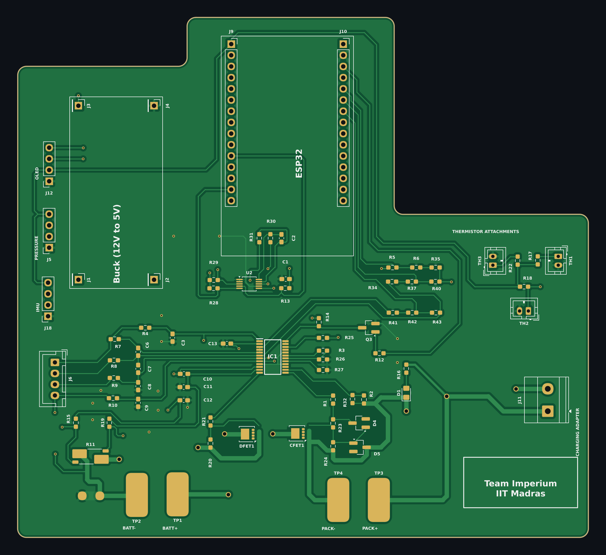
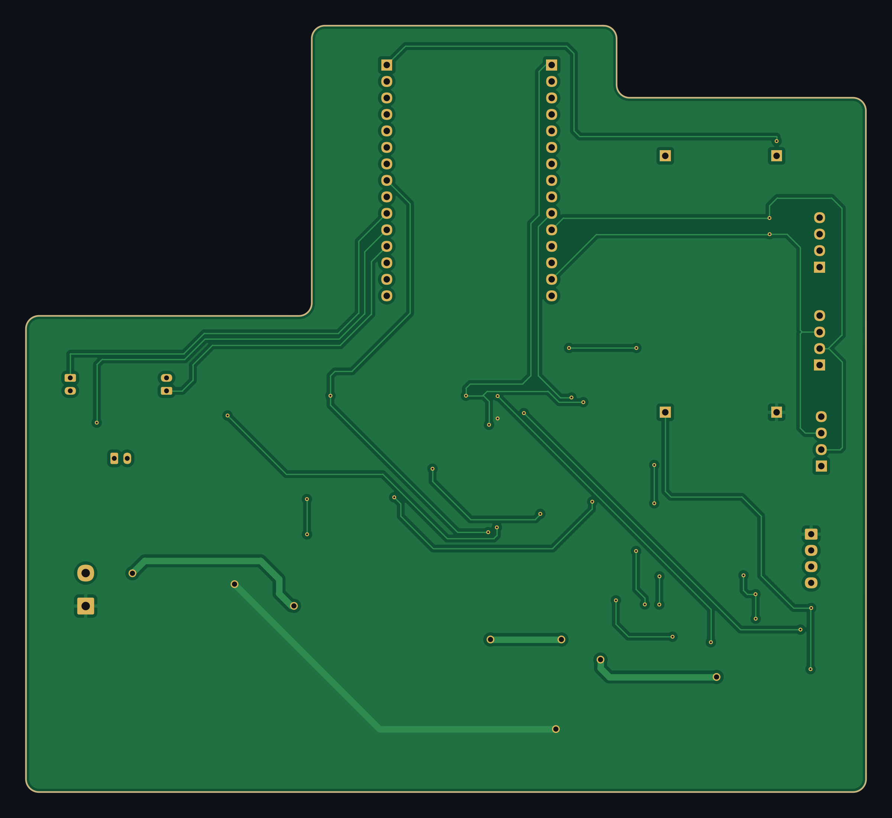

<div align="center">

# Team Imperium — Battery Management System

**A hardware + software BMS for 3-series Li-ion packs: real-time fault detection, graded protection, and SOC/SOH estimation**

*Caterpillar Tech Challenge · IIT Madras*




</div>

---

## Overview

Team Imperium's BMS watches a battery pack's sensors in real time, works out whether something
dangerous is happening, and disconnects the pack before it fails. It has two parts:

- **Custom PCB.** A 2-layer board built around a TI **BQ77915** cell protector, with
  back-to-back **CSD17570Q5B** charge/discharge MOSFETs, an **INA226** current/power monitor on
  a 2 mΩ shunt, three thermistor inputs, and a socket for an **ESP32** dev board.
- **Firmware and toolchain.** ESP32 firmware on FreeRTOS that runs **14 physics-based fault
  detectors**, a severity → action-tier → contactor chain, and an **Unscented Kalman Filter**
  for State of Charge and State of Health. A Python toolchain replays labelled data through
  the same algorithm (Software-in-the-Loop) and scores it against ground truth.

### Highlights

| | |
|---|---|
| **Fault detection** | 14 detectors covering thermal, gas/pressure, mechanical impact, sensor loss, micro-short, voltage/thermal gradients, over/under-voltage, over-current and thermal-runaway precursors |
| **Graded response** | Each fault gets a 0–1 severity, which maps to one of 4 tiers: `NORMAL → INHIBIT_CHG → OPEN_ALL → LATCH_OPEN` |
| **State estimation** | Joint SOC/SOH UKF with a fitted OCV–SOC curve. SOC error is about 3%, down from about 13% with a generic NMC curve |
| **Verification** | The same algorithm runs in C++ on the ESP32 and in Python on a PC, scored against a 36,001-sample labelled dataset |
| **Telemetry** | Live terminal dashboard, matplotlib GUI, serial logs, and a WiFi UDP logger to CSV |

---

## Results

Software-in-the-Loop run over the full labelled dataset (`python monitor.py --sim --no-gui`):

| Metric | Value |
|---|---|
| **Precision** | **99.6 %** (TP 2862 / FP 12) |
| **Recall, all labelled faults** | 56 % |
| **Recall, excluding impedance growth** | 82 % |

| Fault class | Recall |
|---|---|
| Micro-short / abnormal self-heating | 95.0 % |
| Gas generation / pressure build-up | 82.0 % |
| Voltage sensor noise / loose lead | 73.6 % |
| Mechanical impact / obstacle hit | 70.2 % |
| Impedance growth / contact degradation | ≈ 0 % (see below) |

> **Why impedance growth is ≈0 %:** in this dataset it has no per-frame signature. It is a
> multi-cycle ageing effect, so the design tracks it through the UKF's SOH / power-fade trend
> instead of an instantaneous threshold. We kept the thresholds tied to the physics rather than
> tuning them to this dataset. Details are in
> [`software/fault_detection.md`](software/fault_detection.md).

---

## Hardware

<table>
<tr>
<td width="50%"></td>
<td width="50%"></td>
</tr>
<tr>
<td align="center"><b>Top side</b></td>
<td align="center"><b>Bottom side</b> (mirrored, as seen from below)</td>
</tr>
</table>

**Board:** 2-layer FR-4, about 129 × 118 mm, mostly hand-solderable SMD (0603 passives). Both
layers carry poured copper: GND on top and BATT+ on the bottom.

### Key components

| Ref | Part | Role |
|---|---|---|
| IC1 | TI **BQ77915** | 3–5S stackable cell protector: OV/UV, OC, short-circuit, OT/UT, passive balancing |
| Q1, Q2 (CFET / DFET) | TI **CSD17570Q5B** | Low-R<sub>DS(on)</sub> N-MOSFETs for the charge and discharge paths |
| U2 | TI **INA226** | High-side current / bus-voltage / power monitor over I²C |
| R11 | 2 mΩ WSK2512 shunt | Current sense |
| J9, J10 | 1×15 sockets | ESP32 dev board (3V3 side / VIN side) |
| J1–J4 | Pin pads | 12 V → 5 V buck module |
| TH1–TH3 | JST-PH 2-pin | Cell thermistors |
| J6 | JST-XH 4-pin | Cell balance / sense taps (3S) |
| J5, J12, J18 | 1×4 headers | Pressure sensor, OLED, IMU (I²C) |
| J11 | 5.08 mm screw terminal | Charging adapter input |
| TP1–TP4 | 5×10 mm solder pads | `BATT+`, `BATT−`, `PACK+`, `PACK−` |

Full bill of materials: [`hardware/bom/BMS_Imperium_BOM.csv`](hardware/bom/BMS_Imperium_BOM.csv).

### Opening the design

Open `hardware/BMS_Imperium.kicad_pro` in **KiCad 9.0 or later**. The custom footprints
(`BQ7761501`, `TRANS_CSD18512Q5B`) are embedded in the board file, so the PCB opens without the
`BMS.pretty` library. To regenerate Gerbers, use *File → Fabrication Outputs* in the PCB editor;
the job file is in `hardware/fabrication/`.

The PCB images above come from the board file via [`tools/render_pcb.py`](tools/render_pcb.py)
(details under [Regenerating the PCB renders](#regenerating-the-pcb-renders)).

---

## System architecture

```
                         ┌──────────────── PC (Python) ─────────────────┐
  labelled dataset ────► │ monitor.py ──► serial packets ──────────────►│──► ESP32 firmware
  (.xlsx / SIL .csv)     │   │                                          │      ├─ taskRX       (core 0)
                         │   ├─► detector_sim.py  (--sim, PC mirror)    │      ├─ taskProcess  (core 1)
                         │   ├─► dashboard.py / gui_plotter.py          │      │    UKF → 14 detectors
                         │   └─► csv_logger.py ◄── WiFi UDP ◄───────────│──────┤    → severity → tier
                         └──────────────────────────────────────────────┘      │    → MOSFETs / LEDs / buzzer
                                                                               └─ taskWiFiLog  (core 0)
```

**Decision chain, run once per frame:**

```
detectors ──► per-fault severity (0–1) ──► system severity = max ──► tier ──► contactors
                                                                      │
   0.00 ─── NORMAL ─── 0.30 ── INHIBIT_CHG ── 0.55 ── OPEN_ALL ── 0.80 ── LATCH_OPEN ── 1.00
            log + LED         open charge FET        open both FETs       open both + latch
```

The full design is documented in [`software/README.md`](software/README.md), including every
detector, the severity calibration, the run modes and the GPIO map.

---

## Repository structure

```
Team-Imperium/
├── README.md                       ← you are here
├── docs/
│   └── images/                     PCB renders used in this README
├── hardware/                       KiCad 9 project
│   ├── BMS_Imperium.kicad_pro
│   ├── BMS_Imperium.kicad_sch      schematic
│   ├── BMS_Imperium.kicad_pcb      board layout
│   ├── fp-lib-table
│   ├── bom/                        bill of materials (CSV)
│   ├── fabrication/                Gerber job file
│   └── reports/                    schematic → PCB update report
├── software/                       firmware + Python toolchain
│   ├── BMS_ESP32_Demo/             ESP32 Arduino firmware (FreeRTOS)
│   │   ├── BMS_ESP32_Demo.ino      tasks: RX, Process, WiFiLog
│   │   ├── config.h                all thresholds, pins, WiFi settings
│   │   ├── detectors.h             detectors + severity + hardware control
│   │   ├── types.h                 Frame / DetectorState, FaultID enum
│   │   ├── wifi_log.h              UDP payload builder
│   │   └── src/ukf_soh/            on-device SOC/SOH UKF
│   ├── monitor.py                  orchestrator / data player (entry point)
│   ├── detector_sim.py             Python mirror of detectors.h
│   ├── soc_ukf.py                  Python mirror of the UKF
│   ├── bms_state.py                shared state + fault catalogue
│   ├── dashboard.py                Rich terminal dashboard
│   ├── gui_plotter.py              live matplotlib GUI
│   ├── csv_logger.py               WiFi UDP → CSV receiver
│   ├── synthetic_NMC__1C_fault_EIS_dataset.xlsx
│   ├── requirements.txt
│   ├── README.md                   full technical reference
│   ├── fault_detection.md          physics-first detector design spec
│   └── PRESENTATION.md             presenter's guide and Q&A
└── tools/
    └── render_pcb.py               .kicad_pcb → PNG renderer
```

---

## Getting started

### 1. Python toolchain

Requires Python 3.10 or later.

```bash
cd software
```

```bash
pip install -r requirements.txt
```

```bash
python monitor.py
```

Running `monitor.py` with no arguments opens an interactive menu. You can also pick a mode
directly:

| Command | What it does |
|---|---|
| `python monitor.py --sim` | Runs the real detection algorithm on the PC and scores it |
| `python monitor.py --sim --no-gui --speed 1000` | Fast headless scoring with per-fault and per-detector breakdowns |
| `python monitor.py --dry-run` | Replays the dataset's labels (checks the UI only) |
| `python monitor.py --port COM3` | Streams data to the ESP32 over serial (on Linux `/dev/ttyUSB0`, on macOS `/dev/tty.usbserial-*`) |
| `python monitor.py --port COM3 --wifi` | Same, and also logs the board's WiFi telemetry to `wifi_log.csv` |

### 2. ESP32 firmware

1. Install the **ESP32 board package** in the Arduino IDE, plus the *Adafruit SSD1306* and
   *Adafruit GFX* libraries.
2. Open `software/BMS_ESP32_Demo/BMS_ESP32_Demo.ino`.
3. Edit `config.h`. For WiFi logging, set `WIFI_SSID`, `WIFI_PASS` and `LOG_SERVER_IP` (your
   PC's LAN IP).
4. Flash the board, then run `monitor.py --port <PORT>`.

> **Keep the copies in sync:** the thresholds exist in both `config.h` and `detector_sim.py`,
> and the `FaultID` order must match across `types.h`, `bms_state.py` and `detector_sim.py`.
> If you change one, change the others.

---

## Regenerating the PCB renders

```bash
pip install sexpdata matplotlib
```

```bash
python tools/render_pcb.py hardware/BMS_Imperium.kicad_pcb docs/images/pcb
```

This writes `pcb_front.png` and `pcb_back.png`. If you have KiCad 9 installed,
`kicad-cli pcb render` gives photorealistic 3D renders as an alternative.

---

## Documentation

| Document | Contents |
|---|---|
| [`software/README.md`](software/README.md) | Full technical reference: data pipeline, all detectors, severity system, run modes, sensors, GPIO map, tuning workflow |
| [`software/fault_detection.md`](software/fault_detection.md) | Physics-first detector design and the dual-mode RUL plan |
| [`software/PRESENTATION.md`](software/PRESENTATION.md) | Narrative walkthrough, demo script and anticipated Q&A |

---

<div align="center">

**Team Imperium · IIT Madras** — built for the Caterpillar Tech Challenge

</div>
